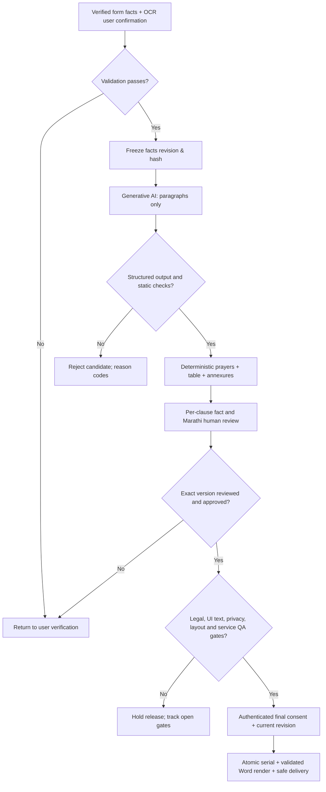

# V28 — मसुदा मंजुरी व Word Issuance State Machine

## Approval boundaries

- **Fact review is not only paragraph-level**: for each sentence or factual clause, the reviewer must identify verified answer(s), check the exact value (dates, gat, width, direction, loss), and mark `supported / correction needed / unknown`.
- **Language review**: plaintiff's affirmative voice, idiomatic Marathi, nonrepetition, correct tense for obstruction state and approved pleading style.
- **Source binding**: approval is tied to `draft_id`, exact `revision`, `request_hash`, `candidate_hash`, approved Master/Ruleset versions and reviewer identity. A client-supplied Boolean is not secure authentication.
- **User final review**: a fresh, unchecked final review consent screen after edits. Any change invalidates consent and paragraph review.
- **Legal review**: source Master expressly marks prayer #2 legal implementation basis for independent verification; limitation boundary cases cannot be deemed valid solely on a timestamp comparison.
- **Template review**: five approved land columns, party order, Marathi text layout, signature/verification section and attached-only annexures. Review actual rendered pages.
- **Production release**: when all gates are complete, the real server must store final approved version, allocate one unique number and revision atomically, verify DOCX was generated successfully and deliver via authorized download. The V28 code does **not** implement this production state.

## States and transitions (implementation specification)

| State | Input/event | Outcome |
|---|---|---|
| `FACTS_INCOMPLETE` | Missing width/date/gat/OCR confirmation | No model request |
| `INPUT_VERIFIED` | Required facts + V17/V18 validation passed | Generate request snapshot |
| `MODEL_DRAFTING` | Provider called server side | Candidate only |
| `REJECTED_STATIC` | Parser, module, source, prayer or claim check fails | Correct facts/regenerate; no Word |
| `PENDING_HUMAN_REVIEW` | Static checks pass | Show clause-by-clause mapping |
| `HUMAN_REVIEWED` | Authenticated reviews tied to exact hashes | Evaluate operational gates |
| `RELEASE_HOLD` | Pending wording, legal, privacy or layout gate | No filing-ready Word |
| `READY_FOR_EXPORT` | Every external gate and final consent passed in actual implementation | Transactional Word generation |
| `EXPORTED` | Word content persisted/delivered after successful generation | Number/revision committed |
| `SUPERSEDED` | Source field, paragraph, attachment or revision changed | Clear all old approvals; new review required |

All real releases are **RELEASE_HOLD** under the present package, because the service is not live and several mandatory approvals remain open.
